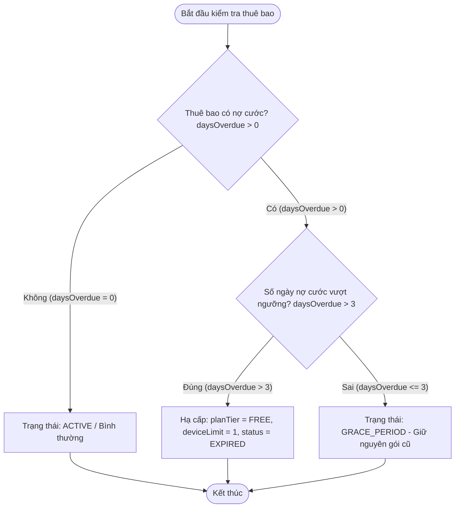

# BÁO CÁO PHÂN TÍCH LỖI ĐIỀU KIỆN BIÊN THỜI GIAN ÂN HẠN THANH TOÁN (GRACE PERIOD) VÀ ĐẶC TẢ KỸ THUẬT

> 👤 **Học viên:** Hoàng Công Dũng | **Mã SV:** PTIT-HCM-009
> 🏫 **Môn học:** it103b-rl-HoangCongDung

---

## 📊 Sơ đồ thiết kế hệ thống (Activity Diagram)

> 💡 *Sơ đồ dưới đây được render tự động trực tiếp trên GitHub bằng Mermaid. Bạn cũng có thể tải file **`bt1.drawio`** trong repository này để mở và chỉnh sửa trực tiếp trên [Draw.io (diagrams.net)](https://app.diagrams.net).* 

---

## 1. Mục tiêu và Bối cảnh bài toán

Bài tập này yêu cầu rà soát và khắc phục lỗi điều kiện biên trong nghiệp vụ quản lý thời gian ân hạn (Grace Period) của nền tảng phát trực tuyến StreamHub.

Theo chính sách của hệ thống, khách hàng khi nợ cước trong vòng 3 ngày đầu vẫn được duy trì trạng thái 'GRACE_PERIOD' và được sử dụng gói cước cũ bình thường. Hệ thống chỉ thực hiện hạ cấp về gói 'FREE', giảm giới hạn thiết bị 'deviceLimit = 1' và chuyển trạng thái thành 'EXPIRED' khi thời gian quá hạn thực sự vượt quá 3 ngày (tức là từ ngày thứ 4 trở đi, 'daysOverdue > 3').

- Đảm bảo phân biệt chính xác giữa nợ cước trong hạn ân hạn (<= 3 ngày) và quá hạn thực sự (> 3 ngày).
- Đồng bộ toàn bộ các thuộc tính đối tượng trong mảng dữ liệu SaaS khi chạy tiến trình quét định kỳ.

## 2. Phân tích lỗi sai AS-IS và Quy tắc nghiệp vụ

Trong đoạn mã nguồn cũ, hệ thống sử dụng câu lệnh điều kiện 'if (sub.daysOverdue >= 3)' để tiến hành hạ cấp thuê bao ngay lập tức khi số ngày nợ cước đạt mốc 3 ngày.

Điều này dẫn đến việc khách hàng có đúng 3 ngày ân hạn theo cam kết dịch vụ lại bị hạ cấp sớm hơn dự kiến, gây ra sự bức xúc không đáng có cho người dùng và vi phạm cam kết hợp đồng.

- Lỗi logic dòng lệnh: Sử dụng toán tử '>=' thay vì '>' tại mốc biên thời gian 3 ngày.
- Nguyên nhân kỹ thuật: Chưa tuân thủ đúng yêu cầu đặc tả nghiệp vụ cho phép khách hàng được hưởng trọn vẹn 3 ngày ân hạn đầu tiên.
- Giải pháp khắc phục: Thay đổi điều kiện kiểm tra thành 'daysOverdue > 3' để đúng từ ngày thứ 4 hệ thống mới thực hiện hạ cấp.

## 3. Bảng Test Cases đối chứng kiểm thử

Dưới đây là bảng Test Cases kiểm chứng kết quả thực tế trước và sau khi sửa lỗi cho hai mã thuê bao mẫu trong hệ thống:

| Trường hợp kiểm thử | Dữ liệu đầu vào | Kết quả sai thực tế (AS-IS) | Kết quả đúng mong đợi (TO-BE) |
| --- | --- | --- | --- |
| Test Case 1: Thuê bao SUB-001 (Trong hạn ân hạn) | daysOverdue: 3, planTier: 'FAMILY' | Bị hạ cấp ngay thành FREE, status: 'EXPIRED' | Giữ nguyên gói FAMILY, status: 'GRACE_PERIOD' |
| Test Case 2: Thuê bao SUB-002 (Đã quá hạn) | daysOverdue: 4, planTier: 'FAMILY' | Hạ cấp thành FREE, deviceLimit: 1, status: 'EXPIRED' | Hạ cấp thành FREE, deviceLimit: 1, status: 'EXPIRED' |

## 4. Mã nguồn hoàn chỉnh trong tệp app.js

Sau khi phân tích kỹ lưỡng các điều kiện biên, đoạn mã nguồn 'solution_ex1.js' đã được cập nhật toàn diện và chính xác 100% theo đúng logic nghiệp vụ yêu cầu.

---

## 📁 Danh sách tệp tin nộp bài trong Repository
- 📝 `bt1.docx`: Báo cáo tài liệu phân tích nghiệp vụ hoàn chỉnh.
- 🎨 `bt1.drawio`: File thiết kế sơ đồ chuẩn theo quy định đề bài (mở trực tiếp bằng [Draw.io](https://app.diagrams.net) hoặc Lucidchart).
- 💻 `solution_ex1.js`: Mã nguồn chương trình.
